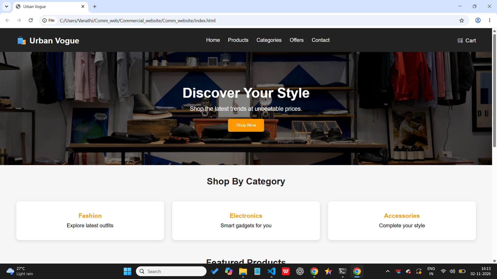
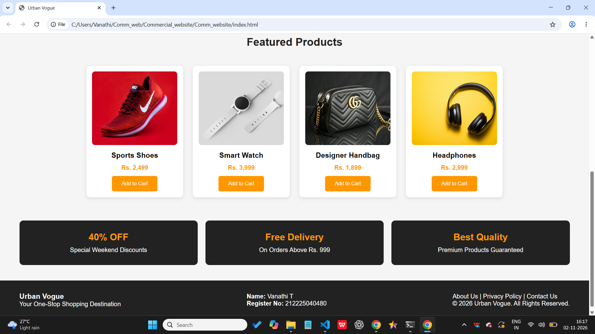

# Ex02 Commercial Website
## Date: 02.11.2026

## AIM
To create a commercial website using CSS Flexbox.

## ALGORITHM
### STEP 1
Create an HTML file (index.html)

### STEP 2
Create a CSS file (style.css)

### STEP 3
Include a navigation bar with links to different sections.

### STEP 4
Add structured sections for Homepage, Products / Services, About Us, Contact Details and User Account.

### STEP 5
Include social media links at the footer with copyright information.

### STEP 6
Define global styles for fonts, colors, and layout.

### STEP 7
Style the header, navigation bar, and sections.

### STEP 8
Use Flexbox for layout design.

### STEP 9
Add hover effects and transitions for interactivity.

### STEP 10
Add Images and Media.

### STEP 11
Use optimized images for a professional look.

### STEP 12
Open the HTML file in a browser to check layout and functionality.

### STEP 13
Fix styling issues and refine content placement.

### STEP 14
Deploy the website.

### STEP 15
Upload to GitHub Pages for free hosting.

## PROGRAM
index.html
```
<!DOCTYPE html>
<html lang="en">
<head>
    <meta charset="UTF-8">
    <meta name="viewport" content="width=device-width, initial-scale=1.0">
    <title>Urban Vogue</title>
    <link rel="stylesheet" href="style.css">
</head>
<body>

    <!-- Header -->
    <header>
        <div class="logo">🛍️ Urban Vogue</div>

        <nav>
            <a href="#">Home</a>
            <a href="#">Products</a>
            <a href="#">Categories</a>
            <a href="#">Offers</a>
            <a href="#">Contact</a>
        </nav>

        <div class="cart">🛒 Cart</div>
    </header>

    <!-- Banner -->
    <section class="banner">
        <div class="banner-content">
            <h1>Discover Your Style</h1>
            <p>Shop the latest trends at unbeatable prices.</p>
            <button>Shop Now</button>
        </div>
    </section>

    <!-- Categories -->
    <h2 class="title">Shop By Category</h2>

    <section class="categories">
        <div class="category">
            <h3>Fashion</h3>
            <p>Explore latest outfits</p>
        </div>

        <div class="category">
            <h3>Electronics</h3>
            <p>Smart gadgets for you</p>
        </div>

        <div class="category">
            <h3>Accessories</h3>
            <p>Complete your style</p>
        </div>
    </section>

    <!-- Products -->
    <h2 class="title">Featured Products</h2>

    <section class="products">

        <div class="product">
            
            <h3>Sports Shoes</h3>
            <p>Rs. 2,499</p>
            <button>Add to Cart</button>
        </div>

        <div class="product">
            
            <h3>Smart Watch</h3>
            <p>Rs. 3,999</p>
            <button>Add to Cart</button>
        </div>

        <div class="product">
            
            <h3>Designer Handbag</h3>
            <p>Rs. 1,899</p>
            <button>Add to Cart</button>
        </div>

        <div class="product">
            
            <h3>Headphones</h3>
            <p>Rs. 2,999</p>
            <button>Add to Cart</button>
        </div>

    </section>

    <!-- Special Offers -->
    <section class="offers">

        <div class="offer-box">
            <h2>40% OFF</h2>
            <p>Special Weekend Discounts</p>
        </div>

        <div class="offer-box">
            <h2>Free Delivery</h2>
            <p>On Orders Above Rs. 999</p>
        </div>

        <div class="offer-box">
            <h2>Best Quality</h2>
            <p>Premium Products Guaranteed</p>
        </div>

    </section>

    <!-- Footer -->
    <footer>
        <div>
            <h3>Urban Vogue</h3>
            <p>Your One-Stop Shopping Destination</p>
        </div>

        <div>
            <p><b>Name:</b> Vanathi T</p>
            <p><b>Register No:</b> 212225040480</p>
        </div>

        <div>
            <p>About Us | Privacy Policy | Contact Us</p>
            <p>© 2026 Urban Vogue. All Rights Reserved.</p>
        </div>
    </footer>

</body>
</html>
```
style.css
```
* {
    margin: 0;
    padding: 0;
    box-sizing: border-box;
    font-family: Arial, sans-serif;
}

body {
    background-color: #f5f5f5;
}

/* Header using Flexbox */
header {
    display: flex;
    justify-content: space-between;
    align-items: center;
    padding: 20px 50px;
    background-color: #222;
    color: white;
}

.logo {
    font-size: 25px;
    font-weight: bold;
}

nav {
    display: flex;
    gap: 25px;
}

nav a {
    color: white;
    text-decoration: none;
    font-size: 16px;
}

nav a:hover {
    color: #ff9800;
}

.cart {
    font-size: 17px;
}

/* Banner */
.banner {
    height: 350px;
    background: linear-gradient(
        rgba(0,0,0,0.5),
        rgba(0,0,0,0.5)
    ), url("https://images.unsplash.com/photo-1441986300917-64674bd600d8?w=1200");
    background-size: cover;
    background-position: center;
    display: flex;
    justify-content: center;
    align-items: center;
    text-align: center;
    color: white;
}

.banner-content h1 {
    font-size: 42px;
    margin-bottom: 15px;
}

.banner-content p {
    font-size: 18px;
    margin-bottom: 20px;
}

button {
    background-color: #ff9800;
    color: white;
    border: none;
    padding: 12px 25px;
    border-radius: 5px;
    cursor: pointer;
}

button:hover {
    background-color: #e68900;
}

/* Section Titles */
.title {
    text-align: center;
    margin: 35px 0 25px;
    font-size: 28px;
    color: #222;
}

/* Categories using Flexbox */
.categories {
    display: flex;
    justify-content: center;
    gap: 25px;
    padding: 20px 50px;
}

.category {
    background-color: white;
    flex: 1;
    padding: 35px 20px;
    text-align: center;
    border-radius: 10px;
    box-shadow: 0 3px 10px rgba(0,0,0,0.1);
}

.category h3 {
    margin-bottom: 10px;
    color: #ff9800;
}

/* Products using Flexbox */
.products {
    display: flex;
    justify-content: center;
    flex-wrap: wrap;
    gap: 25px;
    padding: 20px 50px;
}

.product {
    background-color: white;
    width: 250px;
    padding: 15px;
    text-align: center;
    border-radius: 10px;
    box-shadow: 0 3px 10px rgba(0,0,0,0.1);
}

.product img {
    width: 100%;
    height: 190px;
    object-fit: cover;
    border-radius: 8px;
}

.product h3 {
    margin: 12px 0;
}

.product p {
    color: #ff9800;
    font-weight: bold;
    margin-bottom: 12px;
}

/* Offers using Flexbox */
.offers {
    display: flex;
    justify-content: space-around;
    gap: 20px;
    padding: 40px 50px;
}

.offer-box {
    background-color: #222;
    color: white;
    flex: 1;
    text-align: center;
    padding: 30px 15px;
    border-radius: 10px;
}

.offer-box h2 {
    color: #ff9800;
    margin-bottom: 10px;
}

/* Footer using Flexbox */
footer {
    display: flex;
    justify-content: space-between;
    align-items: center;
    background-color: #222;
    color: white;
    padding: 30px 50px;
}

/* Responsive Design */
@media (max-width: 768px) {

    header {
        flex-direction: column;
        gap: 20px;
    }

    nav {
        flex-wrap: wrap;
        justify-content: center;
    }

    .categories,
    .offers {
        flex-direction: column;
    }

    .products {
        justify-content: center;
    }

    footer {
        flex-direction: column;
        text-align: center;
        gap: 15px;
    }

    .banner-content h1 {
        font-size: 30px;
    }
}
```
## OUTPUT





## RESULT
The program for creating commercial website using CSS Flexbox is executed successfully.
